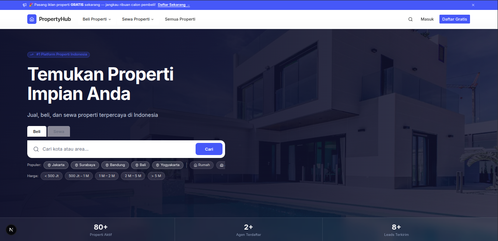

# PropertyHub

Fullstack Indonesian property marketplace platform built with NestJS, Next.js 16, and PostgreSQL within a Turborepo monorepo.



---

## 📖 System Documentation

All architectural specifications, database models, and API contracts are indexed in:
- **[`docs/00_MOC.md`](docs/00_MOC.md)** (Central Documentation Map of Content)
- **[`AGENTS.md`](AGENTS.md)** (Operating Guidelines for AI Agents)

---

## 🏗️ Architecture & Tech Stack

| Layer | Technology | Port | Details |
|---|---|---|---|
| **Backend** | NestJS 11 + Prisma ORM + Bun | `3003` | Modular architecture, JWT cookies, rate limiting, Decimal serialization |
| **Frontend** | Next.js 16 (App Router) + Tailwind v4 + shadcn/ui | `3004` | Server Components, ISR caching, Leaflet maps, Recharts analytics |
| **Shared** | `@propertyhub/shared` TypeScript library | — | Shared domain enums, models, DTOs, and API envelopes |
| **Database** | PostgreSQL 16 (Docker Compose) | `5435` | 15 tables, 20 migrations, spatial indexing, composite indexes |
| **Storage** | Cloudinary | — | Property images & floor plan upload with size limits |
| **Payments** | Midtrans (modular: log / midtrans) | — | Featured listing tiers (Basic, Premium, Ultimate) |

---

## 📁 Monorepo Structure

```text
property-webapp/
├── Makefile              # Canonical command entrypoint (dev, build, docker, migrate)
├── docker-compose.yml    # PostgreSQL container (port 5435) + optional Umami
├── AGENTS.md             # Directives and invariants for AI agents
├── docs/                 # Documentation repository & MOC
│   ├── 00_MOC.md         # Central documentation index
│   ├── API.md            # REST API specification
│   ├── ERD.md            # Entity Relationship Design
│   ├── FRONTEND_GUIDELINES.md # UI constraints & data fetching rules
│   └── ...
├── packages/
│   └── shared/           # @propertyhub/shared domain types and DTOs
└── apps/
    ├── api/              # NestJS backend application (:3003)
    └── web/              # Next.js frontend application (:3004)
```

---

## 🚀 Quick Start

### 1. Start Infrastructure & Database
```bash
make docker-up
```

### 2. Configure Environment Files
```bash
cp apps/api/.env.example apps/api/.env
cp apps/web/.env.example apps/web/.env.local
```

### 3. Run Migrations & Seed Data
```bash
make db-migrate
make db-seed
```

### 4. Start Development Servers
```bash
make dev
```
- Frontend: `http://localhost:3004`
- Backend API: `http://localhost:3003`
- Swagger Docs: `http://localhost:3003/api/docs`

---

## 🔑 Default Accounts (Seeder)

| Role | Email | Password |
|---|---|---|
| **Admin** | `admin@propertyhub.com` | `admin123` |
| **Agent 1** | `agent1@propertyhub.com` | `admin123` |
| **Agent 2** | `agent2@propertyhub.com` | `admin123` |
| **User** | `user@propertyhub.com` | `admin123` |
