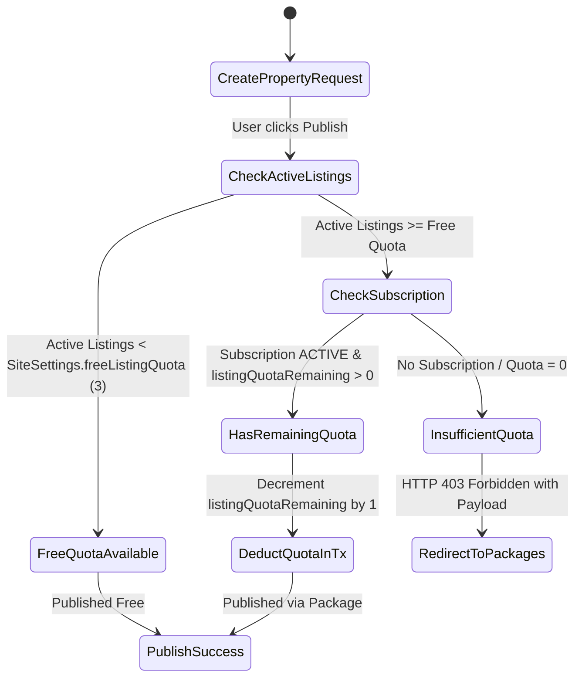
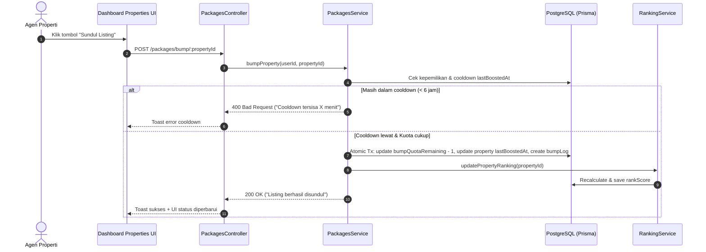

# Software Design Document (SDD): Enterprise Commercial Grade
**System:** PropertyHub — Indonesian Property Marketplace Platform  
**Target Milestone:** Public Commercial Launch & Investment Readiness (Rumah123 Parity)  
**Document Version:** 2.0.0  
**Status:** PROPOSED FOR REVIEW  

---

## 1. Executive Summary & Business Vision

PropertyHub adalah platform marketplace properti nasional di Indonesia yang dirancang untuk bersaing langsung dengan pemain utama (Rumah123, Rumah.com, OLX Properti). 

### 1.1 Core Business Model (Unit Economics)
Platform mengadopsi model **Freemium & Micro-Monetization**:
1. **Free Tier (Flywheel Akuisisi)**: Setiap pemilik properti / agen baru mendapatkan kuota **3 listing gratis**.
2. **Paid Agent Subscriptions (Recurring Revenue / MRR)**:
   - **Starter** (Rp 149.000 / bln): 10 Kuota Listing + 5 Kuota Sundul.
   - **Pro Broker** (Rp 399.000 / bln): 50 Kuota Listing + 25 Kuota Sundul + 2 Featured Listing + Badge Verifikasi Agen.
   - **Enterprise Office** (Rp 999.000 / 3 bln): 200 Kuota Listing + 100 Kuota Sundul + 5 Featured Listing + Badge Verifikasi Agen.
3. **Pay-Per-Feature (Micro-Transactions)**:
   - **Sundul / Bump Listing**: Rp 15.000 / sundul (reset organic freshness ke posisi teratas).
   - **Featured Listing Tiers**: Basic (Rp 99.000/mgg), Premium (Rp 299.000/mgg), Ultimate (Rp 599.000/bln).

---

## 2. Target System Architecture

```mermaid
graph TD
    Client[Web Client: Next.js 16 App Router] -->|HTTPS / WSS| CDN[Edge CDN / Cloudflare]
    CDN -->|Dynamic Requests| API[NestJS API Gateway :3003]
    
    subgraph "Backend Services"
        API --> AuthModule[Auth & Session Service]
        API --> PropertyModule[Property & Ranking Engine]
        API --> PackageModule[Monetization & Quota Engine]
        API --> VerificationModule[Agent Verification & Anti-Fraud]
        API --> PaymentModule[Modular Payment Service: Midtrans / Log]
    end
    
    subgraph "Data & Storage Layer"
        PropertyModule -->|Prisma ORM| PG[(PostgreSQL Dedicated :5435)]
        PackageModule -->|ACID Transactions| PG
        AuthModule --> PG
        API -->|Signed Streaming| Cloudinary[(Cloudinary Asset Storage)]
        API -->|Snap / Webhooks| MidtransGateway[(Midtrans Payment Gateway)]
    end
    
    subgraph "Resiliency & Telemetry"
        API --> HealthCheck[/health Liveness & DB Ping]
        API --> ErrorFilter[Global Structured Error Filter]
    end
```

---

## 3. Detailed Component Specifications

### 3.1 Real Health & Readiness Probe (DevOps & K8s Compliant)
**Problem**: Saat ini `GET /health` mengembalikan hardcode `{ status: "ok" }` tanpa memverifikasi database.  
**Specification**:
- Endpoint: `GET /health`
- Probing Mechanism:
  1. Ping database via `SELECT 1` atau `prisma.$queryRaw` dengan timeout 2000ms.
  2. Ukur latensi database (`dbLatencyMs`).
  3. Cek memori proses Node.js (`heapUsed`, `rss`).
  4. Response Status:
     - HTTP 200: Jika database sehat (`status: "healthy"`).
     - HTTP 503 Service Unavailable: Jika database tidak dapat dijangkau (`status: "unhealthy"`).

```json
{
  "status": "healthy",
  "timestamp": "2026-10-11T12:00:00.000Z",
  "uptime": 1420.5,
  "checks": {
    "database": { "status": "up", "latencyMs": 4 },
    "memory": { "heapUsedMb": 74.2, "rssMb": 132.8 }
  }
}
```

---

### 3.2 Monetization Engine & Quota Lifecycle (Zero Hardcoding)



#### Komponen UI & Frontend Funnel:
1. **Halaman `/dashboard/packages`**:
   - Menampilkan 3 kartu paket: Starter, Pro, Enterprise (data bersumber dinamis dari `GET /packages`).
   - Indikator Paket Aktif: Card "Langganan Anda Saat Ini" menampilkan sisa kuota listing, sisa kuota sundul, dan tanggal kadaluarsa.
   - Tombol "Beli Paket" memicu popup Midtrans Snap checkout atau mode log.
2. **Banner Kuota di Dashboard Overview**:
   - Menampilkan progress bar kuota listing: `3 / 10 Listing Terpakai`.

---

### 3.3 Listing Bump / "Sundul" Engine (Pilar 3)

**Tujuan**: Memberikan agen kemampuan menaikkan kembali listing organik ke urutan pertama pencarian tanpa harus membayar featured mingguan penuh.

#### Rules & Invariants:
1. **Cooldown Enforcement**: Properti hanya dapat disundul jika waktu `Date.now() - property.lastBoostedAt >= SiteSettings.bumpCooldownHours` (default: 6 jam).
2. **Quota Deduction**: Mengurangi 1 `bumpQuotaRemaining` dari langganan aktif agen dalam satu transaksi atomik.
3. **Immediate Ranking Refresh**:
   - `lastBoostedAt` diatur ke `new Date()`.
   - `freshnessScore` diatur kembali ke `100`.
   - Menjalankan `rankingService.updatePropertyRanking(propertyId)` secara real-time.



---

### 3.4 Agent Verification & Anti-Fraud Pipeline (Pilar 4)

**Tujuan**: Membangun kredibilitas trust level platform seperti Rumah123 (Verified Agent badge) serta mencegah listing bodong/scammer.

#### Workflow:
1. **Pengajuan Dokumen oleh Agen (`POST /users/verification`)**:
   - Agen mengisi nomor NIK KTP dan nomor lisensi AREBI.
   - Mengunggah foto KTP dan sertifikat broker (Cloudinary).
   - Sistem otomatis memeriksa tabel `blacklists`: jika nomor telepon atau email ada di daftar hitam, pengajuan langsung ditolak.
2. **Review oleh Administrator (`PATCH /users/verification/:id/review`)**:
   - Status: `APPROVED` atau `REJECTED`.
   - Jika `APPROVED`: field `user.verified` otomatis menjadi `true`, mengirimkan notifikasi in-app.
   - Jika `REJECTED`: menyimpan alasan penolakan (`rejectionReason`) dan memberi kesempatan revisi dokumen.
3. **Badge Proyeksi Publik**:
   - Kartu listing properti dan halaman profil agen (`/agen/[handle]`) otomatis menampilkan badge "Agen Terverifikasi" warna biru dengan ikon centang terverifikasi.

---

### 3.5 Production Packaging & CI/CD Pipeline

#### Production Dockerfile (`Dockerfile.api` & `Dockerfile.web`):
- Multi-stage build berbasis Node.js 20 Alpine / Bun.
- Non-root user execution (`USER node`).
- Next.js Standalone Output (`output: 'standalone'`) untuk memangkas ukuran image dari 1GB+ menjadi ~120MB.

#### CI/CD Workflow (`.github/workflows/ci.yml`):
- Triggers: Push ke branch `main` & Pull Request.
- Jobs:
  1. **Lint & Typecheck**: `turbo lint` & `tsc --noEmit`.
  2. **Unit Tests**: `turbo test` (33 BE tests + 12 FE tests wajib 100% pass).
  3. **Build Check**: `turbo build`.

---

## 4. Database Schema Delta & Integrity Matrix

Tabel dan relasi yang mendukung operasional komersial enterprise:

| Tabel | Tujuan | Strategi Integritas |
|---|---|---|
| `ad_packages` | Katalog paket kuota agen | Configurable via Admin/DB, soft-disable via `isActive` |
| `user_subscriptions` | Kepemilikan kuota aktif agen | Index pada `[userId, status]` dan `[expiresAt]`, cascade delete aman |
| `property_bump_logs` | Audit trail riwayat sundul | Index pada `[propertyId, bumpedAt]`, pencegah manipulasi |
| `agent_verifications` | Berkas verifikasi KTP/AREBI | Unique constraint per user, status audit `[status]` |
| `blacklists` | Daftar hitam anti-fraud | Unique constraint pada nomor/email/IP, auto-rejection |
| `transactions` | Log keuangan Midtrans/Log | **`onDelete: Restrict`** (Dilarang hapus record keuangan) |
| `properties` | Listing marketplace | **Soft Delete (`deletedAt`)**, decoupled views counter |

---

## 5. Phased Implementation Roadmap (TDD Driven)

- **Sprint A: Technical Hardening & Health Telemetry**
  - Implementasi database ping pada `GET /health`.
  - Pembuatan `Dockerfile.api`, `Dockerfile.web`, dan `.github/workflows/ci.yml`.
- **Sprint B: Frontend Monetization & Agent Packages UI**
  - Pembuatan halaman `/dashboard/packages` dengan selector tier paket.
  - Integrasi modal pembayaran Midtrans Snap.
  - Komponen Progress Bar Kuota Listing di header dashboard.
- **Sprint C: Agent Sundul & CRM Experience**
  - Penambahan tombol "Sundul Listing" pada kartu properti di `/dashboard/properties`.
  - Visual feedback countdown timer cooldown sundul.
- **Sprint D: Verifikasi Agen UI & Admin Queue**
  - Form pengajuan KTP/AREBI di `/dashboard/profile`.
  - Halaman review verifikasi agen di `/admin/verifications`.

Dokumen ini siap ditinjau. Jika disetujui, implementasi dapat segera dieksekusi secara terstruktur via TDD.
